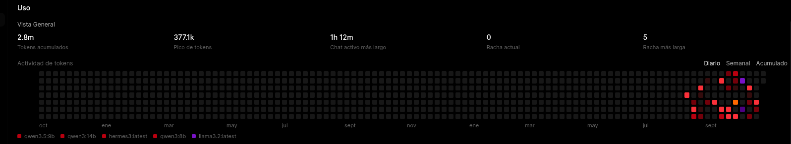

<div align="center">
  
  <h1>🤖 Puck - AI SysAdmin & Infrastructure Middleware</h1>
  <p><em>Asistente de administración inteligente impulsado por LLMs locales para la orquestación, monitoreo y automatización de un entorno Homelab (Proxmox / Docker).</em></p>
</div>

---

**Puck** no es un simple bot de notificaciones, es un *middleware inteligente* escrito en Python. Diseñado para operar como un Site Reliability Engineer (SRE) virtual, Puck unifica la telemetría del sistema, la gestión de incidentes y la consulta de logs en una sola interfaz conversacional y de APIs, y además controla funciones nativas del escritorio (Linux/Wayland).

Aprovechando modelos de lenguaje locales (LLMs) ejecutados de forma 100% privada mediante **Ollama** e interactuando a través de **Open WebUI**, este asistente es capaz de diagnosticar problemas, sugerir comandos de remediación y automatizar tareas del entorno.

<div align="center">
  
  <br/><em>Puck anuncia en Discord que el monitoreo está en línea.</em>
</div>

---

## 🚀 Capacidades Principales y Arquitectura

El ecosistema de Puck se divide en dos grandes módulos funcionales que operan en simultáneo: un backend asíncrono para el manejo de emergencias y un motor de *Function Calling* para la asistencia operativa.

<div align="center">
  
  <br/><em>Arquitectura general. El diagrama es editable: abrí <a href="Assets/Arquitectura%20de%20Puck.excalidraw"><code>Arquitectura de Puck.excalidraw</code></a> en <a href="https://excalidraw.com">Excalidraw</a>.</em>
</div>

### 1. 🚨 Pipeline de Alertas Proactivas (Grafana ➔ Discord)

Puck actúa como el *Webhook Receiver* definitivo para el stack de observabilidad del Homelab, traduciendo métricas frías en lenguaje natural.

*   **Recepción:** Un endpoint dedicado en **FastAPI** (`POST /alertas/discord`) captura los payloads JSON crudos disparados por el Alertmanager de Grafana.
*   **Procesamiento AI:** El script inyecta los datos técnicos (ej. uso de RAM, discos llenos, temperaturas de CPU/GPU) en un prompt estructurado y consulta a la API local de Ollama.
*   **Notificación y Enrutamiento:** La IA formatea el incidente en un resumen de máximo 3 líneas, con personalidad de mayordomo, y lo despacha hacia un canal privado de Discord mediante Webhooks. Si Ollama no responde, Puck igual envía un aviso de respaldo para que ninguna alerta se pierda.

**Reglas de Monitoreo en Grafana** (carpeta *Homelab*, grupo *HomeKing*, evaluación cada 1 minuto): CPU, RAM, espacio en discos, CPU al 85 %, GPU al 85 % y temperatura del M.2.

<div align="center">
  
</div>

**Respuesta y Notificación de Puck en Discord:**

> 📸 **Evidencia:** Puck resume en lenguaje natural las alertas que dispara Grafana. Acá, dos alertas de prueba con su umbral y la indicación de revisar el enlace para confirmar si es un test o una situación real.

<div align="center">
  
</div>

---

### 2. 🧠 Asistencia Operativa mediante Open WebUI (Tools)

A través del sistema de *Tools* (Function Calling) de Open WebUI, Puck le otorga al modelo de lenguaje la capacidad de ejecutar código Python en tiempo real para auditar la infraestructura. Cada tool es un método con una sola responsabilidad:

| Tool | Qué hace | Endpoint de Puck |
|---|---|---|
| `consultar_proxmox` | CPU, RAM, uptime y uso de cada storage | `GET /proxmox/estado` |
| `consultar_grafana` | Alertas activas (*firing*) en Grafana | `GET /grafana/estado` |
| `listar_servicios_con_logs` | Servicios con logs disponibles en Loki | `GET /loki/servicios` |
| `consultar_logs` | Logs recientes de un servicio | `GET /loki/logs` |
| `abrir_aplicacion` / `cerrar_aplicacion` | Abre o cierra apps de una lista blanca | `POST /ejecutar/{app}` · `POST /cerrar/{app}` |
| `controlar_reproductor` | Reproducción y volumen | `POST /media/{accion}` |
| `reproducir_musica` | Busca y reproduce desde Navidrome | SSH + `puck_music.py` |

#### 📊 Telemetría y Monitoreo de Proxmox

Permite interactuar con la infraestructura mediante lenguaje natural (ej. *"¿Cómo está el servidor?"*). El script se conecta directamente a la API de **Proxmox VE** para extraer el consumo de recursos en vivo (CPU/RAM), el uptime y el uso de cada storage (ZFS, LVM, HDD y SSD).

> 📸 **Evidencia:** Puck consulta Proxmox, interpreta los datos y marca qué discos merecen atención (en este caso, el HDD-1TB al 76 %).

<div align="center">
  
</div>

#### 🔧 Troubleshooting y Resolución de Incidentes

Cuando se detecta una anomalía (como un disco al límite de su capacidad), Puck no solo reporta el problema: cruza el dato con las alertas de Grafana y propone acciones concretas, desde encontrar qué ocupa espacio (`df`, `du`) hasta migrar datos a otro storage o expandir el volumen con LVM (`lvdisplay`, `lvextend`, `resize2fs`).

> ⚠️ Los comandos son **orientativos**: Puck usa rutas genéricas que hay que adaptar al entorno real, y nunca ejecuta cambios por su cuenta.

> 📸 **Evidencia:** respuesta de Puck ante el HDD-1TB casi lleno, con las opciones de remediación.

<div align="center">
  
</div>

#### 🪵 Consulta de Logs con Loki (solo lectura)

Puck consulta **Loki** mediante LogQL para entender qué pasó antes (o durante) una alerta. El flujo tiene dos pasos: primero descubre qué servicios tienen logs, y después trae los más recientes, filtrando solo errores o mostrando todo, en una ventana de 1 a 180 minutos.

> 📸 **Evidencia 1:** listado de servicios con logs disponibles (*bazarr, cadvisor, excalidraw, flaresolverr, grafana, homepage, loki, open-webui, prometheus, prowlarr, radarr, sonarr*).

<div align="center">
  
</div>

> 📸 **Evidencia 2:** con un simple *"Revisame todos"*, Puck lanzó **12 consultas** a `consultar_logs` en una sola respuesta y devolvió un diagnóstico por servicio, con problema, causas probables y recomendación.

<div align="center">
  
  <br/><br/>
  
</div>

> 🐛 **Puck detectó un bug de su propio ecosistema:** Open WebUI recibía un `404` al pedir `/v1/audio/voices` al endpoint de TTS del backend. Justo el tipo de problema que pasa desapercibido hasta que alguien lee los logs.

#### 💻 Control de Escritorio y Multimedia (Desktop Automation)

Automatización de la estación de trabajo principal (Linux/Wayland). A través del chat o comandos HTTP, se puede ordenar la apertura o el cierre de aplicaciones de una **lista blanca** (Discord, Konsole, Brave, Zen Browser, Feishin, Steam, Dolphin, Heroic Games), así como controlar la reproducción multimedia a bajo nivel utilizando `wpctl`, `pactl` y `playerctl`.

La música se busca en **Navidrome** (canciones, álbumes y playlists, con modo aleatorio) y se reproduce con **mpv**, regulando el volumen solo del reproductor.

#### 🗣️ Voz Local (Piper TTS)

El endpoint `POST /v1/audio/speech` es compatible con la API de TTS de OpenAI, por lo que Open WebUI puede usarlo directamente. Detrás corre **Piper**, con varias voces en español (incluida la voz `puck`), 100% local.

---

## 📈 Rendimiento y Uso de Modelos (LLMs)

El procesamiento cognitivo recae en modelos de peso medio/alto (como `qwen3:14b`), los cuales son ejecutados localmente para garantizar una latencia mínima y asegurar que la topología de la red y las IPs internas nunca se expongan a servicios de terceros. Durante el desarrollo se probaron también `qwen3.5:9b`, `qwen3:8b`, `hermes3` y `llama3.2`.

> 📸 **Evidencia:** más de 2.8 M de tokens acumulados en Open WebUI durante el desarrollo y las pruebas.

<div align="center">
  
</div>

---

## 🔌 Referencia de la API

| Método | Ruta | Descripción |
|---|---|---|
| `POST` | `/alertas/discord` | Recibe alertas de Grafana, las resume con IA y las envía a Discord |
| `GET` | `/proxmox/estado` | Estado del nodo y de los storages |
| `GET` | `/grafana/estado` | Alertas activas en Grafana |
| `GET` | `/loki/servicios` | Servicios con logs disponibles |
| `GET` | `/loki/logs?servicio=&minutos=&solo_errores=` | Logs recientes de un servicio |
| `POST` | `/ejecutar/{app}` · `/cerrar/{app}` | Abre o cierra una app de la lista blanca |
| `POST` | `/media/{accion}` | `play`, `pause`, `play-pause`, `next`, `previous`, `stop`, `volume-up`, `volume-down` |
| `POST` | `/v1/audio/speech` | TTS compatible con OpenAI (Piper) |

---

## ⚙️ Instalación Rápida

```bash
git clone https://github.com/francostefanodot06/Puck_Assistant.git
cd Puck_Assistant
pip install fastapi uvicorn requests
uvicorn Puck_Assistant:app --host 0.0.0.0 --port 8000
```

1. **Configurá** los valores `TU_*` de `Puck_Assistant.py` (Proxmox, Grafana, Ollama, Discord, Piper). Loki ya lee `LOKI_URL` y `LOKI_LABEL` desde variables de entorno.
2. **Grafana:** creá un *contact point* de tipo Webhook apuntando a `http://IP_DE_PUCK:8000/alertas/discord`.
3. **Open WebUI:** en *Workspace → Tools*, pegá los scripts de tools y completá la IP de la PC y el puerto de Puck.
4. **Voz (opcional):** en *Ajustes → Audio*, motor *OpenAI* con URL `http://IP_DE_PUCK:8000/v1` y voz `puck`.
5. **Música (opcional):** copiá `puck_music.py` a la PC de escritorio, configurá Navidrome y habilitá SSH por clave.

---

## 🔒 Seguridad

*   **Lista blanca de comandos:** solo se pueden abrir o cerrar las apps definidas en `COMANDOS_PERMITIDOS`; el resto devuelve `403`.
*   **Loki validado y de solo lectura:** el servicio pedido se valida contra la lista real de Loki antes de armar la consulta LogQL, y las respuestas se limitan en cantidad y tamaño.
*   **Logs como datos no confiables:** cada respuesta de logs advierte al LLM que no obedezca instrucciones que aparezcan dentro (defensa contra *prompt injection*).
*   **Tokens mínimos:** se recomienda un token de Proxmox de solo lectura (`PVEAuditor`).
*   **Importante:** los endpoints **no tienen autenticación**, así que Puck debe correr solo en red local o detrás de una VPN.

---

## 🛠️ Stack Tecnológico y Librerías

El backend está construido sobre **Python 3**, utilizando un enfoque modular:

**Backend, APIs y Comunicación:**
*   `fastapi` & `uvicorn`: Framework asíncrono de altísimo rendimiento para levantar el servidor receptor de webhooks.
*   `requests`: Para la orquestación HTTP/REST con APIs externas (Ollama, Discord Webhooks, Grafana Alertmanager, Loki).
*   **Proxmox API:** Peticiones mediante *API Tokens* para extraer telemetría del clúster sin exponer credenciales de administrador.

**Observabilidad:**
*   **Grafana + Prometheus:** métricas y reglas de alerta.
*   **Loki (LogQL):** logs centralizados de los contenedores del Homelab.

**Automatización de SO y Audio:**
*   `os` / `subprocess`: Librerías nativas para la manipulación de procesos del sistema operativo.
*   `playerctl` / `pactl` / `wpctl` / `mpv`: control multimedia en Wayland, con **Navidrome** como biblioteca musical.
*   **Piper TTS:** Motor de Text-to-Speech neuronal de ejecución local para generar respuestas de voz ultra-rápidas.

**Integración IA:**
*   **Ollama:** inferencia local de los modelos.
*   **Open WebUI Tools:** Scripts Python inyectados dinámicamente en la interfaz web que habilitan el *Function Calling* para los modelos de Ollama.

---

## 🗺️ Roadmap

- [ ] Autenticación por API key en los endpoints
- [ ] Endpoint `GET /v1/audio/voices` (detectado por el propio Puck en los logs)
- [ ] Acciones con aprobación humana por Discord (Aprobar / Rechazar)
- [ ] Tool de Docker (`ps`, `logs`, `restart` con confirmación)
- [ ] Briefing matutino automático del estado del homelab
- [ ] Correlación automática de alertas con logs de Loki
- [ ] Entrada de voz con Whisper y *wake word*

---

*Nota de Seguridad: Las credenciales, URLs de Webhooks y Tokens de API deben gestionarse mediante variables de entorno y nunca subirse al repositorio.*
