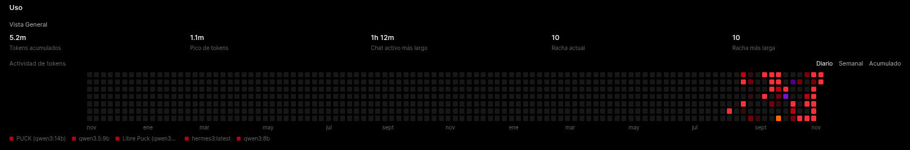

<div align="center">
  
  <h1>🤖 Puck - AI SysAdmin & Infrastructure Middleware</h1>
  <p><em>Asistente de administración inteligente impulsado por LLMs locales para el monitoreo, el diagnóstico y la consulta de un entorno Homelab (Proxmox / Docker).</em></p>
</div>

---

**Puck** no es un simple bot de notificaciones, es un *middleware inteligente* escrito en Python. Diseñado para operar como un Site Reliability Engineer (SRE) virtual, unifica la telemetría de Proxmox, las alertas de Grafana, los logs de Loki y el estado del stack de descargas en una sola API, pensada para que un LLM local la use como herramientas (*Function Calling*).

Aprovechando modelos de lenguaje locales ejecutados de forma 100% privada mediante **Ollama** e interactuando a través de **Open WebUI**, Puck es capaz de diagnosticar problemas y sugerir comandos de remediación. La API corre en un contenedor **LXC** de Proxmox con **FastAPI**.

> 👀 **Puck es de solo lectura:** consulta Proxmox, Grafana, Loki, el stack de descargas y qBittorrent, pero nunca ejecuta cambios en el homelab. Si hace falta modificar algo, propone el comando y lo ejecuta una persona.

<div align="center">
  
  <br/><em>Puck anuncia en Discord que el monitoreo está en línea.</em>
</div>

---

## 🚀 Capacidades Principales y Arquitectura

El ecosistema de Puck se divide en dos grandes módulos: un pipeline que recibe alertas y las explica en lenguaje natural, y un conjunto de endpoints de consulta que Open WebUI expone al modelo como herramientas.

<div align="center">
  
  <br/><em>Arquitectura general. El diagrama es editable: abrí <a href="Assets/Arquitectura%20de%20Puck.excalidraw"><code>Arquitectura de Puck.excalidraw</code></a> en <a href="https://excalidraw.com">Excalidraw</a>.</em>
</div>

### 1. 🚨 Pipeline de Alertas Proactivas (Grafana ➔ Loki ➔ IA ➔ Discord)

Puck actúa como el *Webhook Receiver* del stack de observabilidad del Homelab, traduciendo métricas frías en lenguaje natural y **correlacionándolas con los logs** del servicio afectado.

*   **Recepción:** un endpoint en **FastAPI** (`POST /alertas/discord`) captura los payloads JSON que dispara el Alertmanager de Grafana.
*   **Correlación con Loki:** Puck identifica el servicio de cada alerta a partir de sus *labels* (`LOKI_LABEL`, `job` o `container`) y trae hasta 10 líneas de error de los últimos 30 minutos, con los secretos enmascarados.
*   **Procesamiento AI:** la alerta y los logs se inyectan en un prompt estructurado y se consulta a la API local de Ollama (`qwen3:14b`).
*   **Notificación:** la IA resume el incidente en un máximo de 4 líneas, con tono profesional, y lo despacha a un canal privado de Discord mediante Webhooks. Si Ollama falla, Puck avisa por Discord del fallo.

**Reglas de Monitoreo en Grafana** (carpeta *Homelab*, grupo *HomeKing*, evaluación cada 1 minuto): CPU, RAM, espacio en discos, CPU al 85 %, GPU al 85 % y temperatura del M.2.

<div align="center">
  
</div>

**Respuesta y Notificación de Puck en Discord:**

> 📸 **Evidencia:** Puck resume en lenguaje natural las alertas que dispara Grafana. Acá, dos alertas de prueba con su umbral y la indicación de revisar el enlace para confirmar si es un test o una situación real.

<div align="center">
  
</div>

> 🔑 El contact point de Grafana debe enviar la API key: en el webhook, configurá el header de autorización con esquema `Bearer` y como credencial el valor de `API_KEY`.

---

### 2. 🧠 Asistencia Operativa mediante Open WebUI (Tools)

A través del sistema de *Tools* (Function Calling) de Open WebUI, Puck le otorga al modelo la capacidad de consultar la infraestructura en tiempo real. Cada capacidad es un endpoint con una sola responsabilidad:

| Tool | Qué puede consultar | Endpoint de Puck |
|---|---|---|
| `reporte_homelab` | Resumen general (nivel global del homelab) | `GET /homelab/resumen` |
| `consultar_proxmox` | CPU, RAM, uptime y uso de cada storage | `GET /proxmox/estado` |
| `listar_maquinas_virtuales` | VMs y CTs: estado, CPU y RAM | `GET /proxmox/vms` |
| `estado_smart_discos` | Salud SMART de los discos físicos | `GET /proxmox/discos` |
| `estado_backups_proxmox` | Historial de backups automáticos (`vzdump`) | `GET /proxmox/backups` |
| `consultar_grafana` | Alertas activas (*firing*) en Grafana | `GET /grafana/estado` |
| `estado_descargas_arr` | Radarr, Sonarr, Prowlarr, Bazarr y qBittorrent | `GET /homelab/arr` |
| `listar_servicios_con_logs` | Servicios con logs disponibles en Loki | `GET /loki/servicios` |
| `consultar_logs` | Logs recientes de un servicio | `GET /loki/logs` |
| `revisar_todos_los_logs` | Errores recientes de todos los servicios en una sola consulta | `GET /loki/todos` |
| `consultar_actualizaciones` | Actividad de Watchtower: imágenes nuevas y actualizaciones de contenedores | `GET /homelab/actualizaciones` |

> 🧾 El comportamiento del modelo (modo solo lectura, uso obligatorio de herramientas para el estado del homelab, anti-alucinación y troubleshooting incremental) se define con un **system prompt** cargado en el modelo de Open WebUI.

#### 📊 Telemetría y Monitoreo de Proxmox

Permite interactuar con la infraestructura mediante lenguaje natural (ej. *"¿Cómo está el servidor?"*). El backend se conecta a la API de **Proxmox VE** y extrae:

*   Consumo de recursos en vivo (CPU/RAM), uptime y uso de cada storage (ZFS, LVM, HDD y SSD).
*   Estado de cada VM y contenedor LXC.
*   **Salud SMART** de los discos físicos (NVMe y HDD).
*   **Historial de backups `vzdump`**: los últimos 5 con fecha, duración y resultado.

Las métricas de uso llegan con una etiqueta ya calculada (`[a vigilar]` desde 80 %, `[CRÍTICO]` desde 90 %), para que el modelo no tenga que interpretar los umbrales.

> 📸 **Evidencia:** Puck consulta Proxmox, interpreta los datos y marca qué discos merecen atención (en este caso, el HDD-1TB al 76 %).

<div align="center">
  
</div>

#### 🔧 Troubleshooting y Resolución de Incidentes

Cuando se detecta una anomalía (como un disco al límite de su capacidad), Puck no solo reporta el problema: cruza el dato con las alertas de Grafana y propone acciones concretas, desde encontrar qué ocupa espacio (`df`, `du`) hasta migrar datos a otro storage o expandir el volumen con LVM (`lvdisplay`, `lvextend`, `resize2fs`).

> ⚠️ Los comandos son **orientativos**: Puck usa rutas genéricas que hay que adaptar al entorno real, y nunca ejecuta cambios por su cuenta.

> 📸 **Evidencia:** respuesta de Puck ante el HDD-1TB casi lleno, con las opciones de remediación.

<div align="center">
  
</div>

#### 📥 Stack de Descargas

`GET /homelab/arr` revisa en una sola llamada:

*   **Radarr y Sonarr** (API `v3`) y **Prowlarr** (API `v1`): consulta su endpoint de `health` y reporta avisos y errores.
*   **Bazarr:** verifica que la API responda.
*   **qBittorrent:** verifica que la WebUI esté en línea. Requiere habilitar *Bypass de autenticación para clientes en la lista blanca de IPs* **solo para la IP del contenedor de Puck**.

Si falta la API key de algún servicio, el reporte lo indica en lugar de fallar.

#### 🔄 Actualizaciones de Contenedores (Watchtower)

`GET /homelab/actualizaciones` lee en Loki los logs de **Watchtower** de las últimas 24 horas y devuelve las 15 líneas más recientes, para saber qué imágenes nuevas se detectaron o qué contenedores se actualizaron. Requiere que Watchtower tenga logs en Loki bajo el valor `watchtower` de `LOKI_LABEL`.

#### 🪵 Consulta de Logs con Loki (solo lectura)

Puck consulta **Loki** mediante LogQL para entender qué pasó antes (o durante) una alerta. Filtra solo errores o muestra todo, en una ventana de 1 a 180 minutos. Para una revisión general, `GET /loki/todos` consulta todos los servicios en paralelo y devuelve un resumen compacto.

*   **Límites:** máximo 40 líneas por consulta y 300 caracteres por línea (la revisión general se acota a unos 6500 caracteres en total).
*   **Servicio validado:** el nombre se compara contra la lista real de Loki antes de armar la consulta LogQL.
*   **Redacción de secretos:** cada línea pasa por un filtro que enmascara valores de `password`, `token`, `secret`, `api_key` y `Authorization`.

> 📸 **Evidencia 1:** listado de servicios con logs disponibles (*bazarr, cadvisor, excalidraw, flaresolverr, grafana, homepage, loki, open-webui, prometheus, prowlarr, radarr, sonarr*).

<div align="center">
  
</div>

> 📸 **Evidencia 2:** con un simple *"Revisame todos"*, Puck lanzó **12 consultas** de logs en una sola respuesta y devolvió un diagnóstico por servicio, con problema, causas probables y recomendación.

<div align="center">
  
  <br/><br/>
  
</div>

> 🐛 **Puck detectó un bug de su propio ecosistema:** Open WebUI recibía un `404` al pedir `/v1/audio/voices` al endpoint de TTS. Justo el tipo de problema que pasa desapercibido hasta que alguien lee los logs.

#### 🧭 Resumen General

`GET /homelab/resumen` devuelve un panorama rápido: CPU y RAM de Proxmox y las alertas activas de Grafana, con un nivel global 🟢 `OK`, 🟡 `A VIGILAR` o 🔴 `CRÍTICO`. Los umbrales se configuran con `UMBRAL_VIGILAR` y `UMBRAL_CRITICO`.

---

## 📈 Rendimiento y Uso de Modelos (LLMs)

El procesamiento cognitivo recae en modelos de peso medio/alto (como `qwen3:14b`), ejecutados localmente para garantizar una latencia mínima y asegurar que la topología de la red y las IPs internas nunca se expongan a servicios de terceros. Durante el desarrollo se probaron también `qwen3.5:9b`, `qwen3:8b`, `hermes3` y `llama3.2`.

> 📸 **Evidencia:** más de 2.8 M de tokens acumulados en Open WebUI durante el desarrollo y las pruebas.

<div align="center">
  
</div>

---

## 🔌 Referencia de la API

**Todas las rutas requieren** el header `Authorization: Bearer <API_KEY>`.

| Método | Ruta | Descripción |
|---|---|---|
| `POST` | `/alertas/discord` | Recibe alertas de Grafana, las correlaciona con logs de Loki, las resume con IA y las envía a Discord |
| `GET` | `/homelab/resumen` | Nivel global (OK / A VIGILAR / CRÍTICO) con Proxmox y Grafana |
| `GET` | `/proxmox/estado` | Estado del nodo y de los storages |
| `GET` | `/proxmox/vms` | VMs y CTs: estado, CPU y RAM |
| `GET` | `/proxmox/discos` | Salud SMART de los discos físicos |
| `GET` | `/proxmox/backups` | Últimos 5 backups `vzdump` |
| `GET` | `/grafana/estado` | Alertas activas en Grafana |
| `GET` | `/homelab/arr` | Salud de Radarr, Sonarr, Prowlarr, Bazarr y qBittorrent |
| `GET` | `/homelab/actualizaciones` | Actividad de Watchtower en las últimas 24 h (vía Loki) |
| `GET` | `/loki/servicios` | Servicios con logs disponibles |
| `GET` | `/loki/logs?servicio=&minutos=&solo_errores=` | Logs recientes de un servicio |
| `GET` | `/loki/todos?minutos=&solo_errores=` | Revisión rápida de todos los servicios en paralelo |

---

## ⚙️ Instalación Rápida

Pensado para correr en un contenedor LXC (Debian/Ubuntu) con acceso de red a Proxmox, Grafana, Loki, Ollama y el stack de descargas.

```bash
git clone https://github.com/francostefanodot06/Puck_Assistant.git /opt/Puck_Assistant
cd /opt/Puck_Assistant
python3 -m venv venv
./venv/bin/pip install fastapi uvicorn requests
```

1. **Configurá** los valores del bloque de configuración de `Puck_Assistant.py`: Proxmox, Grafana, Ollama, Discord, API keys del stack de descargas, qBittorrent y, sobre todo, **`API_KEY`** (cambiala por una clave larga y aleatoria). `LOKI_URL` y `LOKI_LABEL` se leen de variables de entorno.
2. **Proxmox:** creá un usuario y un token con el rol `PVEAuditor` (solo lectura).
3. **Levantá el servicio:**

```bash
./venv/bin/uvicorn Puck_Assistant:app --host 0.0.0.0 --port 8000
```

   O como servicio de systemd:

```ini
# /etc/systemd/system/puck.service
[Unit]
Description=Puck API
After=network-online.target
Wants=network-online.target

[Service]
User=puck
WorkingDirectory=/opt/Puck_Assistant
Environment=LOKI_URL=http://IP_DE_LOKI:3100
ExecStart=/opt/Puck_Assistant/venv/bin/uvicorn Puck_Assistant:app --host 0.0.0.0 --port 8000
Restart=on-failure

[Install]
WantedBy=multi-user.target
```

4. **Grafana:** creá un *contact point* de tipo Webhook apuntando a `http://IP_DE_PUCK:8000/alertas/discord`, con el header de autorización `Bearer` y la misma API key.
5. **qBittorrent:** en *Opciones → WebUI*, habilitá el bypass de autenticación para la IP del contenedor de Puck (solo esa IP, `/32`).
6. **Open WebUI:** en *Workspace → Tools*, pegá los scripts de tools y completá la IP de Puck, el puerto y la API key. Cargá además el system prompt en el modelo que uses con Puck.

---

## 🔒 Seguridad

*   **Solo lectura:** el backend únicamente hace consultas `GET` a Proxmox, Grafana, Loki, el stack de descargas y qBittorrent. No existe ningún endpoint que modifique el homelab.
*   **Autenticación por API key:** todas las rutas exigen `Authorization: Bearer <API_KEY>`, comparada en tiempo constante. Con `API_KEY` vacía, todo responde `401`.
*   **Loki validado:** el servicio pedido se valida contra la lista real de Loki antes de armar la consulta LogQL, las respuestas se limitan en cantidad y tamaño, y los secretos se enmascaran.
*   **Logs como datos no confiables:** el system prompt de Puck indica ignorar cualquier instrucción que aparezca dentro de logs, alertas o respuestas de herramientas (defensa contra *prompt injection*).
*   **Tokens mínimos:** token de Proxmox con rol `PVEAuditor` y bypass de qBittorrent limitado a la IP del contenedor.
*   **Sin TLS:** la API corre sobre HTTP, así que la API key viaja en claro. Puck debe correr solo en red local, detrás de una VPN (Tailscale) o de un reverse proxy con HTTPS.

---

## 🛠️ Stack Tecnológico y Librerías

El backend está construido sobre **Python 3**, utilizando un enfoque modular:

**Backend, APIs y Comunicación:**
*   `fastapi` & `uvicorn`: framework y servidor para el receptor de webhooks y la API de tools.
*   `requests`: orquestación HTTP/REST con APIs externas (Proxmox, Ollama, Discord Webhooks, Grafana Alertmanager, Loki, *arr y qBittorrent).
*   **Proxmox API:** peticiones mediante *API Tokens* para extraer telemetría, SMART y backups sin exponer credenciales de administrador.

**Observabilidad:**
*   **Grafana + Prometheus:** métricas y reglas de alerta.
*   **Loki (LogQL):** logs centralizados de los contenedores del Homelab.

**Integración IA:**
*   **Ollama:** inferencia local de los modelos.
*   **Open WebUI Tools:** scripts Python inyectados dinámicamente en la interfaz web que habilitan el *Function Calling* para los modelos de Ollama.

---

## 🗺️ Roadmap

Puck seguirá siendo un **observador**: todo lo que sigue es de solo lectura.

**Hecho**
- [x] Autenticación por API key en todos los endpoints
- [x] Correlación automática de alertas con logs de Loki
- [x] Salud SMART de discos y estado de backups `vzdump`
- [x] Integración del stack de descargas (Radarr, Sonarr, Prowlarr, Bazarr, qBittorrent)
- [x] Consulta de logs con Loki, revisión general y redacción de secretos
- [x] Seguimiento de actualizaciones de contenedores con Watchtower

**Próximos pasos**
- [ ] Resumen completo: sumar discos, backups, stack de descargas y errores de Loki a `/homelab/resumen`
- [ ] Reporte proactivo a Discord (briefing matutino) con anti-repetición
- [ ] Aviso de respaldo con el detalle crudo de la alerta cuando Ollama no responde
- [ ] SMART detallado: desgaste de NVMe y temperatura
- [ ] Métricas de Prometheus de solo lectura (consultas PromQL predefinidas): contenedores caídos y predicción de días hasta que se llene un disco
- [ ] Cola de descargas (qBittorrent, Sonarr, Radarr) e indexadores caídos
- [ ] Chequeos de disponibilidad de servicios (HTTP/TCP)
- [ ] Bitácora de incidentes para detectar problemas recurrentes
- [ ] Registro de auditoría de cada llamada a la API
- [ ] Entrada de voz con Whisper y *wake word*

---

*Nota de Seguridad: Las credenciales, URLs de Webhooks y Tokens de API deben gestionarse mediante variables de entorno y nunca subirse al repositorio.*
